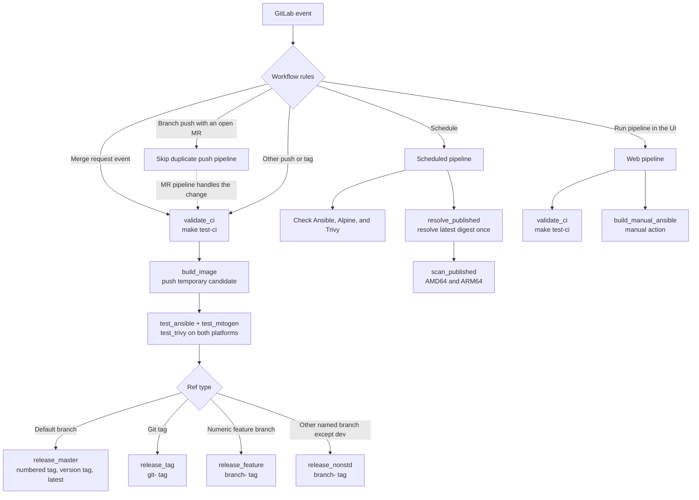

# CI and local Make commands

This page describes the jobs in `.gitlab-ci.yml`, when GitLab runs them, and
which Make target provides a local counterpart. The Make targets use the same
scripts where possible. Registry publication and pipeline routing stay under
GitLab control.

Every job inherits the `chataigne` runner tag unless its configuration
overrides it. The regular build uses Docker Buildx to create one
`linux/amd64` and `linux/arm64` image candidate.

The default CI image is `docker:git`, with `docker:dind` as its service. Jobs
can replace either setting. Regular jobs log in to the GitLab registry with
`CI_JOB_TOKEN` when they inherit the shared `before_script`. Stable release
jobs also use Docker Hub when both Docker Hub credentials are configured.

## Pipeline flow



The workflow creates a merge request pipeline for merge request events. If a
branch already has an open merge request, GitLab skips the duplicate branch
push pipeline. A push without an open merge request, a tag pipeline, or another
allowed pipeline source follows the regular build and test stages.

Scheduled pipelines do not build an image. They check upstream versions and
scan the current GitLab `latest` digest. A web pipeline runs `validate_ci` and
shows `build_manual_ansible` as a manual job; it does not run the regular image
tests or release jobs.

## Jobs and Make equivalents

| GitLab job | Runs when | What it does | Local Make equivalent |
| --- | --- | --- | --- |
| `check_ansible_release` | Schedule | Checks PyPI and opens an update MR when Ansible or its compatible `ansible-core` needs an update. | `make check-ansible-release` reports the update without changing GitLab. |
| `check_alpine_release` | Schedule | Checks the latest Alpine 3.x tag for a newer patch or digest and opens an update MR. | `make check-alpine-release` reports the update. It also needs Docker Buildx. |
| `check_trivy_release` | Schedule | Checks the latest Trivy release and image digest, then opens an update MR. | `make check-trivy-release` reports the update. It also needs Docker Buildx. |
| `validate_ci` | Every source except schedule | Runs ShellCheck and the simulated CI/release tests. | `make test-ci` |
| `build_image` | Regular push, merge request, tag, or other non-web, non-schedule pipeline | Builds and pushes a temporary multi-platform candidate, then exports its immutable digest as `TESTED_IMAGE`. | `make build` builds locally and loads the image into Docker. It does not create the CI candidate. |
| `build_manual_ansible` | Web pipeline, started manually | Builds the selected Ansible version and publishes a `manual-...` tag. | No direct equivalent. `make build` uses the versions in `versions.env`. |
| `test_ansible` | Regular pipeline | Checks the installed Ansible and `ansible-core` versions, then runs `ansible --version` and `ansible-lint --version` against `TESTED_IMAGE`. | `make test-ansible` runs the checks against the local image. |
| `test_mitogen` | Regular pipeline | Imports Mitogen from `TESTED_IMAGE`. | `make test-mitogen` checks the local image. |
| `test_trivy` | Regular pipeline, AMD64 and ARM64 jobs | Scans `TESTED_IMAGE` on each platform for HIGH and CRITICAL findings. Secret scanning stays enabled. | `make test-trivy` scans the locally built image for the host platform. |
| `resolve_published` | Schedule | Resolves GitLab `latest` once and exports its digest for the scan jobs. | Included in `make scan-published`. |
| `scan_published` | Schedule, AMD64 and ARM64 jobs | Scans the resolved published digest without building or publishing an image. | `make scan-published` resolves the tag once and scans the configured platforms. |
| `release_master` | Default branch pipeline | Calls the guarded release target after all tests pass. | `make release` is the same entry point, but refuses to run outside the GitLab release job. |
| `release_tag` | Git tag pipeline | Promotes the tested image to `git-<tag>`. | No direct Make equivalent. |
| `release_feature` | Branch matching `<number>-...` | Promotes the tested image to `branch-<branch-slug>`. | No direct Make equivalent. |
| `release_nonstd` | Letter-prefixed branch other than the default branch or `dev` | Promotes the tested image to `branch-<branch-slug>`. | No direct Make equivalent. |

The regular pipeline runs the validation stage first, then the build, tests, and
matching release job. Test jobs receive the digest produced by `build_image`;
they do not rebuild the image. Release jobs run only after the test stage
succeeds.

## Image build and release

`build_image` reads the pins from `versions.env`, uses Buildx and QEMU to build
AMD64 and ARM64 images, and pushes a temporary tag named
`ci-<pipeline-id>-<job-id>`. It records the resulting manifest digest in the
dotenv artifact consumed by later jobs.

The Ansible, Mitogen, and Trivy jobs test that digest. Each writes a validation
artifact containing the exact `TESTED_IMAGE` it checked. `release_master`
requires all four records, verifies the candidate's labels and digest, and
checks that the default branch still points to the pipeline commit. Its
`resource_group` serializes releases.

GitLab's container registry tracks numbered revisions for each Ansible version:
`<ansible-version>-1`, `<ansible-version>-2`, and so on. A retry with the same
digest reuses its tag. The release job publishes the numbered tag and version
alias, then moves `latest` only when the Ansible version is equal to or newer
than the version already published. If both `DOCKER_HUB_USER` and
`DOCKER_HUB_PASSWORD` are set, stable release tags are also published to
Docker Hub. Keep numbered GitLab tags out of registry cleanup policies; they
are the revision ledger.

Other refs use separate names. Git tag pipelines publish `git-<tag>`, and
feature branch pipelines publish `branch-<slug>`. These jobs promote the tested
digest and do not update stable aliases.

## Scheduled checks and scans

Create a daily or weekly pipeline schedule for the default branch. Configure a
masked `GITLAB_API_TOKEN` with permission to read repository files, create
branches and commits, and open merge requests. GitLab supplies
`CI_API_V4_URL`, `CI_PROJECT_ID`, and `CI_DEFAULT_BRANCH` to the jobs.

The update jobs run independently:

- Ansible is checked against PyPI. The script reads the compatible
  `ansible-core` requirement from the selected Ansible release.
- Alpine is checked against Docker Hub's `alpine:3` tag, so the job follows the
  latest 3.x release. It compares both the patch version and the multi-platform
  image digest.
- Trivy is checked against the latest GitHub release and the matching Docker
  Hub image digest.

Each changed pin opens an MR with a changelog entry. The jobs do not merge
those MRs. The Alpine updater keeps `versions.env`, the Dockerfile default, and
the CI image references in sync. The Trivy updater changes the Makefile and CI
image pin.

The Alpine updater tracks the major `3` tag and rejects version downgrades.

The scheduled scan resolves GitLab `latest` once, then scans the same digest on
AMD64 and ARM64. It does not rebuild the image. A failed scan needs review even
when all upstream pins are current. The scan also requires a published
`latest` tag.

## Make command reference

Run `make` or `make help` to list the targets. `versions.env` is required and
supplies the image pins.

| Command | Behavior |
| --- | --- |
| `make check-versions` | Checks required pins and their Dockerfile build arguments. |
| `make setup-buildx` | Creates and selects the local Buildx builder used by this Makefile. |
| `make login` | Logs in to configured registries when credentials are available. |
| `make build` | Builds the local image and loads it into Docker; skips the build if that tag already exists locally. |
| `make test-ci` | Runs ShellCheck, simulated CI/release tests, and version-comparison checks. It does not build an image or access registries. |
| `make test-ansible` | Checks the local image's Ansible and `ansible-core` versions and command versions. |
| `make test-mitogen` | Checks the Mitogen Python import in the local image. |
| `make test-trivy` | Scans the local image with the pinned Trivy image. It uses the Docker socket and local Trivy cache. |
| `make test` | Runs `test-ci` and all image tests. The image is built once as needed. |
| `make all` | Builds the image, then runs `make test`. |
| `make check-ansible-release` | Reports an Ansible update using the local `versions.env`. |
| `make check-alpine-release` | Reports an Alpine patch or digest update. Requires Docker Buildx. |
| `make check-trivy-release` | Reports a Trivy version or digest update. Requires Docker Buildx. |
| `make check-updates` | Runs the Ansible, Alpine, and Trivy checks in sequence. |
| `make scan-published` | Resolves `latest` once, then scans its digest on `SCAN_PLATFORMS`. |
| `make release` | Invokes the GitLab release script. It refuses ordinary local execution. |
| `make clean` | Removes the Trivy cache and removes the local Buildx builder only when this Makefile created it. |

Local update targets use read-only `--check` mode. They need internet access,
`curl`, `jq`, and a `sort` implementation that supports `-V` (GNU coreutils).
Alpine and Trivy checks also need Docker Buildx to resolve registry digests.
They report changes without editing files or opening MRs.
`make test-ci` needs Make, Git, Python 3 with PyYAML, `jq`, and ShellCheck.

`make scan-published` needs Docker access and registry access. Set
`CI_REGISTRY_USER` and `CI_JOB_TOKEN` for a private GitLab registry. Trivy uses
those values as credentials unless `TRIVY_USERNAME` and `TRIVY_PASSWORD` are
set. Override `CI_REGISTRY_IMAGE` to select another image and
`SCAN_PLATFORMS` to select platforms, for example:

```sh
make scan-published SCAN_PLATFORMS=linux/arm64
```

## Manual Ansible build

Use GitLab's **Run pipeline** form to start a manual build. The form defaults
`MANUAL_ANSIBLE_VERSION` to `13.7.0`. Leave `MANUAL_ANSIBLE_CORE_VERSION` empty
to resolve a compatible core version from PyPI, or set it explicitly. The job
publishes `manual-<version>-<commit>` unless `MANUAL_IMAGE_TAG` supplies a
different suffix. It requires Docker Hub credentials and does not run the
regular tests or move stable tags.
